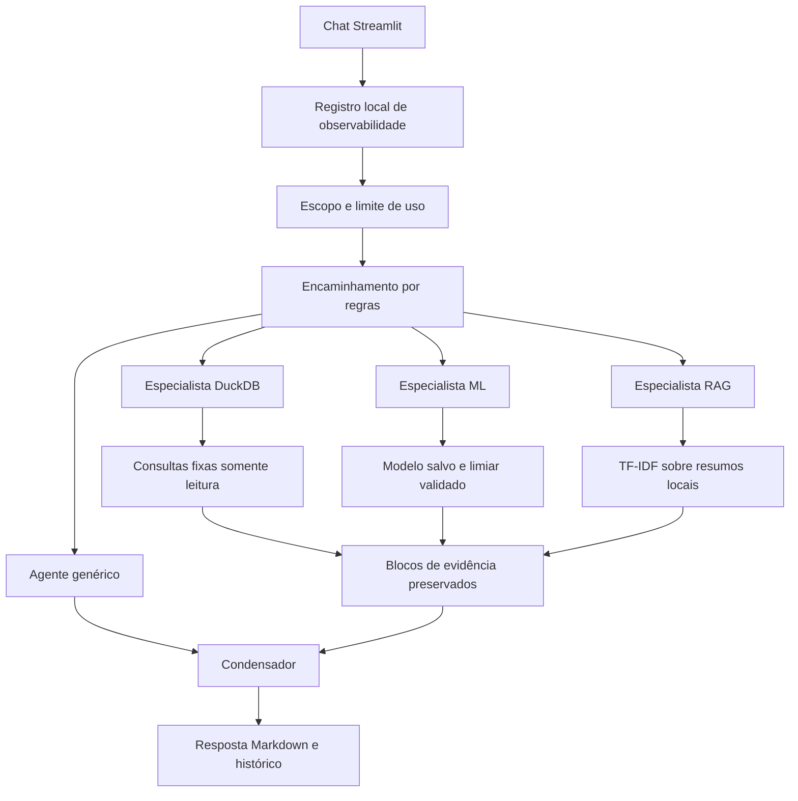

# Arquitetura dos agentes OXICOR

## Fluxo real da etapa 2

| Papel | Responsabilidade | Ferramentas |
|---|---|---|
| Agente genérico | Orientação sobre o OXICOR quando a pergunta aceita não aciona especialista | Nenhuma |
| Especialista DuckDB | Consultas agregadas autorizadas | `consultar_duckdb` |
| Especialista ML | Classificar um perfil completo ou informar dados faltantes | `prever_diabetes` |
| Especialista RAG | Apresentar trechos recuperados e suas fontes | `consultar_rag` |
| Condensador | Ordenar os blocos verificados para apresentação | Nenhuma |

O encaminhamento é determinístico. Não é um sexto agente LLM. Saudações e bloqueios podem ser respondidos por regras antes da criação da equipe. Uma pergunta pode acionar mais de um especialista, mas cada execução utiliza apenas os necessários.

## Execução e permissões

`run_multi_agent` cria agentes e tarefas CrewAI. O orquestrador executa a ferramenta obrigatória antes da tarefa do especialista e mantém o resultado em cache por solicitação. O especialista recebe a evidência; se seu texto a modificar além de espaços, o sistema usa a evidência original. O condensador devolve uma ordem de índices, validada antes da montagem final. Não há delegação irrestrita nem SQL produzido pelo modelo.

As permissões são limites das ferramentas oferecidas, não isolamento de processos por agente. O container usa usuário sem privilégios, mas os agentes compartilham o processo Python. Não há autorização individual de usuários nesta versão.

## Recuperação científica

O modo padrão `local` indexa parágrafos de três resumos Markdown com TF-IDF e recupera até dois trechos por pergunta. Os trechos são apresentados sem reescrita e com o nome do arquivo e seção. O modo anterior via Flowise permanece selecionável pela configuração `OXICOR_RAG_BACKEND=flowise`.

A recuperação lexical tem limitações com sinônimos e perguntas vagas. A presença da citação identifica a origem do trecho, mas não atesta que a fonte original foi integralmente validada. Os resumos devem passar por revisão de conteúdo e de referências antes de uso além da demonstração acadêmica.

## Handoffs e monitoramento

O chat mostra agente ativo, execução de ferramenta e resposta verificada, com expander para os eventos. A área Observabilidade registra solicitações reais em SQLite, com identificador, duração, status, rota, eventos e tokens informados pelo provedor. Não armazena raciocínio interno bruto. O painel permite exportar JSON.

O painel Avaliação apresenta os resultados reais de `evaluate_golden.py`. A suíte usa 15 casos definidos em `evaluation/golden.json`, verifica rota e fatos esperados, e calcula preservação das evidências. Os resultados são proxies de regressão e devem ser complementados por revisão humana e avaliação semântica mais ampla.

## Modelo ativo

HistGradientBoostingClassifier, com 19 preditores e sem ID. O limiar 0,13 foi escolhido na validação. As métricas são de uma partição de teste separada; perfis idênticos não atravessam as partições. O modelo anterior é preservado localmente, mas a inferência prioriza o artefato de `data/models/etapa2/`.

O resultado se refere ao alvo observado no CDC, sem horizonte de previsão futura. A baixa precisão e a ausência de validação externa impedem tratar a saída como diagnóstico ou risco individual calibrado.
